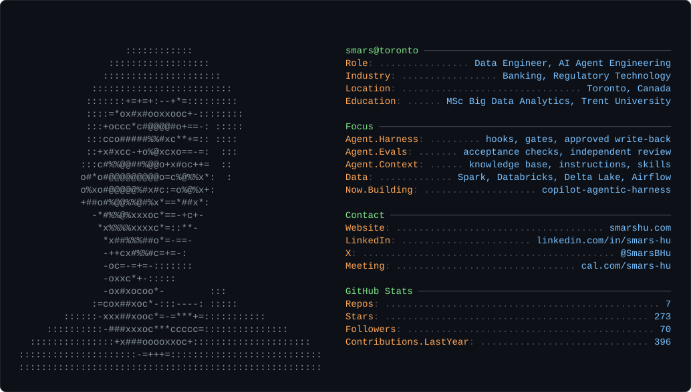

I'm Smars, a data engineer in Toronto. I work in banking, where an AI agent is only useful if you can prove what it did and stop it from doing what it shouldn't. That is the problem I build for.

## What I'm building

### [copilot-agentic-harness](https://github.com/Smars-Bin-Hu/copilot-agentic-harness)

A harness that wraps GitHub Copilot in VS Code so a team can let an agent work on real repositories.

- **Rules enforced by code.** Hooks check every tool call before it runs. Out-of-scope writes, `.git` changes and dangerous commands are rejected, whatever the prompt says.
- **Tasks that survive a new session.** Each task is a directory holding the requirement, plan, progress and result, so a fresh session picks up where the last one stopped.
- **Independent review.** The agent that did the work does not grade it. A separate reviewer and coded acceptance checks do.
- **Human-approved write-back.** The agent works in a task directory and reads the target repository's `main`. Changes reach the target only through a promote you approve, on a new branch.

Python standard library only, no `pip install`. Runs on macOS and Windows.

## Earlier work: data engineering

| Project | What it is | |
| --- | --- | --- |
| [EComDWH-BatchDataProcessingPlatform](https://github.com/Smars-Bin-Hu/EComDWH-BatchDataProcessingPlatform) | A five-layer data warehouse for e-commerce orders on a self-managed cluster: Spark, Airflow, ClickHouse, with CI/CD and monitoring. |  |
| [azure-cloud-datapipeline-EDA](https://github.com/Smars-Bin-Hu/azure-cloud-datapipeline-EDA) | A lakehouse pipeline on Azure Databricks with Delta Lake, Unity Catalog and Data Factory. |  |

## Tech stack

### AI agent engineering

**Coding agents**

  

**Harness engineering**

     

**Context engineering**

     

**Multi-agent workflow**

    

**Evals and verification**

   

### Data engineering

**Languages**

  

**Data processing and lakehouse**

     

**Orchestration, quality and governance**

     

**Cloud and DevOps**

   

## Certificates

## Find me

